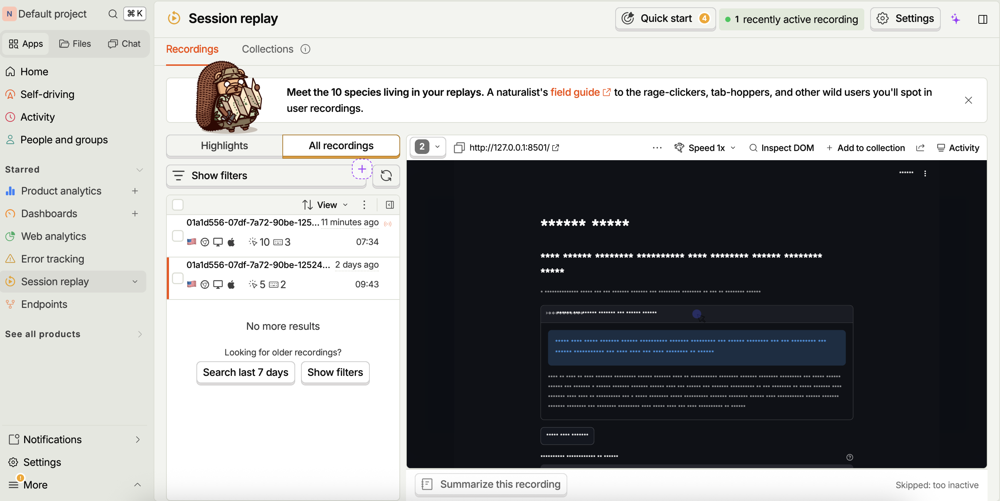

# Build 2 — Smallest Local Version & PostHog

Updated November 15, 2026 · Builder: victor-zu-97 · Pod 12

Build due: Monday, November 16, 2026 at noon, New York time. These are optional working notes; publish the required PRD summary and build log on docs/index.html. Unreported inputs below are not completed evidence.

## 1. What was made

### Resumed testing checkpoint — November 15

November 15 builder review completed: extraction 18.70 seconds / $0.00229428; evaluation 19.69 seconds / $0.00278643; total 38.39 seconds / $0.00508071, model deepseek/deepseek-v4.1-flash, prompt v1.2. Builder confirmed the feedback worked. This is one builder assessment, not independent accuracy validation; reference expectations and findings were not supplied. The supplied PostHog screenshot shows today’s replay entry (11 minutes ago), an older entry (2 days ago), and one recently active recording. The selected older replay visibly masks app text. Today’s recording is present; complete playback through today’s feedback and event properties are not established by this still image. Published-page analytics verification remains pending.

Updated Build 2 elapsed session time: 76.546 minutes (1.28 hours) through November 15, 12:23:48.017 p.m. America/New_York, across three non-overlapping recorded windows. Includes gaps and agent activity; not verified active builder effort. Excludes the break between the two November 15 sessions and work after the cutoff. Supersedes the earlier 0.67-hour snapshot; the historical approximately two-hour Build 1 estimate is separate.

- Recorded local checkpoints: `698d2ee` (PostHog instrumentation) and `e7237eb` (evidence/timing documentation), both November 13. This November 15 documentation checkpoint includes PRD v2, archive/guest planning, scope alignment, reflection, time, and cost evidence. The builder requested commit/push before the next test session; this worksheet does not establish successful push or deployment timing.
- Product Page: https://building-with-ai-f26.github.io/vz2228-RubricRadar/ . Last recorded public-page verification: November 8; published-page analytics verification remains pending. Local demo: http://127.0.0.1:8501 while Streamlit is running.
- Implemented: pasted instructions/draft → consent → extraction → edited requirement confirmation and review → validated feedback with up to three priorities. Shared PostHog instrumentation is installed on the local app and Product Page source. Local pageviews/clicks and initial masked replay were observed November 13.
- Planned only: Class → Assignment → Saved reviews, local SQLite, explicit saves/deletion, and initial Continue as guest entry. No archive, database, or guest entry button is implemented.

## 2. Learn with AI — Requests, APIs, .env & Analytics

### Trace of Confirm & review my draft

1. The browser sends the student's button interaction and current widget state to the Streamlit server. app.py checks sharing consent and calls input validation.
2. confirmed_requirements in radar.py creates the final requirement IDs and retains source excerpts for unchanged extracted items; changed/new entries are marked student-provided.
3. evaluate calls OpenRouter from the server with instructions, draft paragraphs, and confirmed requirements. The API key is loaded from the local environment, not browser code. Routing requires denied data collection, ZDR, and parameter support; requests time out after 90 seconds.
4. The response is checked for required fields, one finding per confirmed requirement, recommendation limits, and exact draft evidence. Unverified evidence becomes Needs Review, and linked recommendations are withheld.
5. app.py renders statuses, evidence, and priorities and retains them in session memory. A request error shows a recoverable message. The implemented app does not save a review to disk.
6. Separately, browser analytics sends a fixed-name confirm_review click. That click indicates intent; it is not a model-completion signal. Analytics and replay must not contain coursework.

### Questions presented to the builder November 15

Builder answers received November 15 are preserved below, with separate agent clarifications. The third answer needs follow-up; no corrected answer is attributed to the builder.

1. What would break if the OpenRouter key were missing or placed in browser code?
   - Builder answer: “That would be catastrophic, the app wont work and the key would need to be changed and checked if it hasnt break any limits.”
2. Why must changing the instructions invalidate the old extracted requirements and feedback?
   - Builder answer: “Changing the instructions invalidate old feedback because now you compare a text to other requirements that could or not be the same.”
3. What would go wrong if we treated a Confirm & review click as proof that a review completed successfully?
   - Builder answer: “Maybe the user wont click on that and the review wont be saved.”

Agent clarifications: For question 1, a missing key prevents live requests; an exposed key requires rotation and a usage/billing check. For question 2, the answer correctly identifies that the comparison baseline has changed. For question 3, a click records an attempt; the API may fail or the response may be rejected afterward, so it does not establish successful completion. The current app does not save reviews. Builder confirmation of this third distinction is still pending.

## 3. What the agent did and where the builder directed it

- Agent: Codex. Earlier recorded work used Codex through ChatGPT Plus; the exact agent model and project subscription allocation are unreported. Configurable app model: deepseek/deepseek-v4.1-flash; prompt version v1.2.
- November 13: added shared analytics, rerun initialization guard, fixed control-name click mapping, masking settings, tests, setup guidance, and evidence records.
- November 15: documented PRD v2, current architecture/contracts, risks, cost evidence, recovery, and an optional local archive plan; reconciled AGENTS.md with current and planned boundaries.
- Builder decisions: requested continuing Build 2, reported classmates' class/professor archive feedback, selected the organized archive approach, and required a guest path. The builder authorized planning and documentation; feature implementation remains a separate step.
- Hand edits or context reset by builder: unreported. No claim that the archive was built or usability-tested.

## 4. Problems, failures, and recovery

- November 13: static preview port binding failed in the sandbox, then worked with execution approval. Browser extension access was unavailable; native Chrome controls allowed inspection. Replay needed app-document script execution and a rerun initialization guard. See tests/README.md for observed results and limits.
- November 15: a static planning assertion required the exact phrase no user isolation, while the document described that boundary with other wording. Clarified the phrase; the recovery check passed. This was a documentation-check failure, not a runtime failure.
- Alignment review found blanket persistence prohibitions that conflicted with the planned archive and an overly broad uncertainty criterion. Documentation now distinguishes current session-only behavior from future explicit saves and matches Needs Review wording to the implemented prompt. No app behavior changed.

## 5. Costs, time, and budgets

| Item | Known evidence / pending input |
| --- | --- |
| New product inference for November 13 analytics and November 15 documentation | $0; no app/OpenRouter calls made for those steps. Development-agent token usage is recorded separately below. |
| Historical reported inference | $0.029571218 partial total; includes three earlier runs and excludes unreported usage. Not the complete Build 2 bill. |
| Observed unit costs | Three earlier full reviews: $0.003135, $0.01418914, $0.012247078. November 15 full review: $0.00508071 / 38.39 seconds; builder confirmed it worked. |
| Session-based Build 2 time requested by builder | Updated Build 2 elapsed session time: 76.546 minutes (1.28 hours) through November 15, 12:23:48.017 p.m. America/New_York, across three non-overlapping recorded windows. Includes gaps and agent activity; not verified active builder effort. Excludes the break between the two November 15 sessions and work after the cutoff. Supersedes the earlier 0.67-hour snapshot; the historical approximately two-hour Build 1 estimate is separate. |
| Coding-agent/subscription allocation | Builder confirms Plus. Approximate API-equivalent development estimate: $14.21 at supplied rates without a cached-input discount; not an actual charge. Subscription allocation remains unreported. |
| Hosting and PostHog billing | Unreported. App remains local; no public app deployment. |
| Proposed weekly API budget | Awaiting builder input; no cap or provider alert is asserted to be configured. |
| Proposed weekly engineering-time budget | Awaiting builder input. |

### Cost update — builder evidence supplied November 15

**Product runtime:** The builder's OpenRouter screenshot displays **$0.08 spend in the last 30 days**, with one model, DeepSeek V4.1 Flash. The figures are rounded account-dashboard values, not an itemized project bill or Build 2-only subtotal. The displayed $0.01 average does not identify complete two-call reviews and must not be called cost per review. The earlier $0.029571218 is a historical subtotal for three individually recorded runs; it is not added to the $0.08 dashboard figure. Project-only attribution and failed/retry spending remain unreconciled. A subsequent November 15 full review measured $0.00508071; do not add it to the earlier rounded dashboard value as an exact account total.

**Development:** Builder confirms using Plus and requests an approximate statement of what API usage could have cost. The session logs record gpt-6.1-sol and Plus plan metadata. Sum each response's usage once, cross-check against the last cumulative thread counter, and do not add cumulative snapshots together. The following frozen snapshot excludes subsequent investigation/documentation work:

| Session | Input tokens | Cached input (included in input) | Output tokens | Total tokens | API-equivalent estimate |
| --- | ---: | ---: | ---: | ---: | ---: |
| November 13, through 09:45:02.263 America/New_York | 4,393,800 | 4,257,408 | 11,509 | 4,405,309 | $8.90 |
| November 15, through 11:29:07.957 America/New_York | 2,544,457 | 2,452,992 | 21,355 | 2,565,812 | $5.30 |
| Combined | 6,938,257 | 6,710,400 | 32,864 | 6,971,121 | **Approximately $14.21** |

Calculation uses the builder-supplied assumptions of $2 per million input tokens and $10 per million output tokens, applying the full input rate to cached tokens: (6,938,257 × $2 + 32,864 × $10) / 1,000,000 = $14.205154. These rates are assumptions for this scenario, not independently verified model pricing or the builder's bill. About 96.7% of input was cached; a discounted cached-input rate would lower the estimate. Reasoning tokens are included in output and are not charged again. No separate dollar charges appear in the inspected token records. Actual development spending is the Plus subscription and any purchased credits, with project allocation unreported; do not add $14.21 to actual expenses or present it as paid spending. Product OpenRouter spending remains separate. Token and elapsed-time snapshots have different stated cutoffs.

### Historical session-time snapshot (superseded below)

Read timestamp metadata from the two local Codex session logs; no credentials or assignment text were copied into project documentation. At the builder's request, use the following elapsed windows for the session-based Build 2 time estimate:

| Session | First recorded event → cutoff (America/New_York) | Elapsed |
| --- | --- | --- |
| November 13 | 09:25:06.139 → 09:45:02.277 | 1,196.138 seconds (19 min 56 sec) |
| November 15 | 11:06:28.147 → latest builder turn start, 11:26:29.848 | 1,201.701 seconds (20 min 2 sec) |
| Combined | Sum of the two windows; no overnight interval included | 2,397.839 seconds = 39.964 minutes = 0.6661 hours (rounded to 0.67 hours) |

Source session IDs: `01a1d54b-ce1c-7ea0-9a8a-30d6ead8ffb1` (November 13) and `01a1dff5-140a-7503-836d-cbc472e6df49` (November 15), under the local Codex sessions directory. The filename start time differs from the first recorded event; this calculation uses recorded timestamps. These windows include reading, waiting, and between-message gaps, exclude work outside the logs, and do not establish active builder effort. The earlier eight-minute November 13 checkpoint window is a subset, not additional time. Recompute later if reporting the eventual full session total; do not count this cutoff as the end of the current session.

### Updated session-time calculation and provenance — November 15

| Session (America/New_York) | Recorded window | Elapsed seconds |
| --- | --- | ---: |
| November 13 | 09:25:06.139–09:45:02.277 | 1196.138 |
| November 15, earlier session | 11:06:28.147–11:38:13.731 | 1905.584 |
| November 15, resumed testing | 11:58:56.975–12:23:48.017 | 1491.043 |
| Total | No overnight interval or inter-session break | 4592.765 |

Updated Build 2 elapsed session time: 76.546 minutes (1.28 hours) through November 15, 12:23:48.017 p.m. America/New_York, across three non-overlapping recorded windows. Includes gaps and agent activity; not verified active builder effort. Excludes the break between the two November 15 sessions and work after the cutoff. Supersedes the earlier 0.67-hour snapshot; the historical approximately two-hour Build 1 estimate is separate. Source IDs: `01a1d54b-ce1c-7ea0-9a8a-30d6ead8ffb1`, `01a1dff5-140a-7503-836d-cbc472e6df49`, `01a1e025-5d71-7910-bab0-f6d619b688db`. Session starts and completed session ends use log timestamp metadata; the resumed-session cutoff uses the current system clock at final documentation refresh. The $14.21 hypothetical development-token estimate retains its original cutoff and is not refreshed by a time calculation.

## 6. Pod critique

- Reported by builder November 15: classmates suggested organizing assignment/rubric history by MBA class and professor.
- Product response: planned class archive with assignment-specific checks; builder added an initial guest path for students who do not want organization/setup.
- Podmate names, actual feedback date, whether they tried the app or discussed the idea, and sign-off: awaiting builder input. Do not infer a successful usability test from the suggestion.

## 7. Current delivery checklist (verified against assignment November 15)

Builder confirmation, November 15: published Product Page analytics and today’s complete replay through feedback/masking are completed. These are builder-reported checks; the agent did not independently replay today’s session or inspect public-page event properties in this step. The still screenshot remains evidence of session activity and the displayed masked replay.

Current Icerynk Build 2 brief verified November 15: working real AI/API action shown on the Product Page; PostHog pageviews/clicks/replay on page and app; PRD v2 covering biggest risk, test, architecture and cost/run; AGENTS.md setup/structure; two outside-class commit dates and updated progress/lessons/problems/costs/hours. Submission is Product Page link, repo link, and a PostHog screenshot showing events; bring the running laptop app to pod testing. Weekly budgets, account-setting confirmation and pod names/sign-off are optional project follow-ups, not stated Build 2 submission requirements. Learn with AI is explicitly ungraded; a documented synthetic reference test is useful quality work, not an additional stated Build 2 requirement.

Source: [current Build 2 assignment](https://www.icerynk.com/content/build-2-plan-md-smallest-version-live?course=fa26-tech-gb-2160-dm2-f2), inspected in the authenticated course browser. Previous planning notes about budgets, account controls, pod names/sign-off and reflection follow-up are optional project work, not submission blockers.

- Completed: [Activity/events screenshot](../docs/images/posthog-events-2026-11-15.jpg) captured directly from PostHog. Agent captured PostHog Activity → Events in the sixth Chrome tab on November 15. Last-hour list showed three local-app events at http://127.0.0.1:8501/: one Pageview and two ui_clicked, with recording links on the click rows. This verifies received local-app events; it does not inspect event properties or independently verify public-page traffic. Public-page analytics and complete feedback replay remain builder-confirmed complete. The events screenshot is ready to attach to the Build 2 submission.
- Commit/push the approved evidence update and verify publication. Two recorded work dates already exist locally; verify remote state after publishing.
- Submit Product Page and repository links plus the events screenshot; bring the running local app to pod testing. No submission was made by the agent.

## Resume next session

Analytics and complete replay are builder-confirmed complete. Events screenshot is captured; finish submission packaging and publication. Archive/guest functionality remains separately planned and unimplemented.
